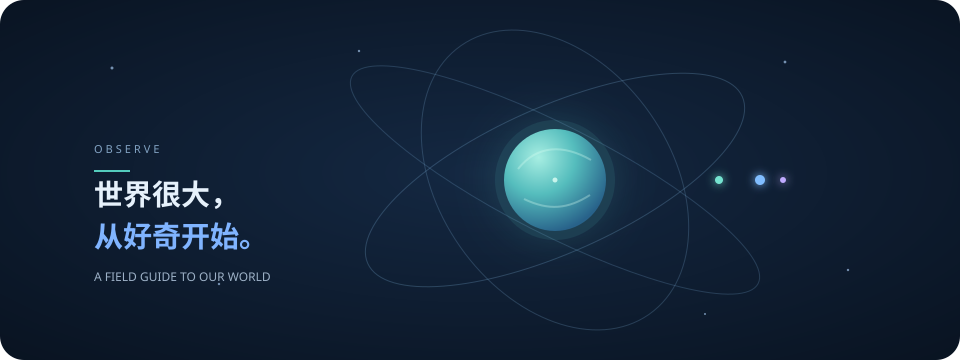

<div align="center">
  
  <p><sub>轨道粒子动画 · 多种视角，环绕同一个世界</sub></p>
</div>

<div align="center">
  <h1>认识这个世界</h1>
  <p><strong>世界很大，从好奇开始。</strong></p>
  <p>从头顶的星空，到脚下的土地；从生命如何诞生，到未来将去向何方。<br>用简单的故事，慢慢读懂我们身处的世界。</p>
  <p>
    <a href="https://luskyle.github.io/the-world/">打开网站 ↗</a>
    &nbsp;·&nbsp;
    <a href="#六个主题">探索主题</a>
    &nbsp;·&nbsp;
    <a href="#从星空开始">开始阅读</a>
  </p>
</div>

---

## 这是什么？

这是一个用通俗叙事认识世界的内容项目。我们从**天文、环境、生命、文化、科技、未来**六个彼此关联的方向出发，观察世界从何而来、如何运转，以及可能走向何方。

不把复杂当深刻，也不把简单当浅薄。我们从一个问题、一段故事或一个熟悉的现象开始，沿着事实和证据，一步步把事情讲清楚。

## 六个主题

| 主题 | 从这里出发 |
|:---|:---|
| **天文** | 仰望星空，认识宇宙、恒星、行星，以及地球在其中的位置。 |
| **环境** | 看见气候、生态与人类生活之间的联系。 |
| **生命** | 探索生命的起源、多样性与演化。 |
| **文化** | 从历史、语言与日常生活理解人类。 |
| **科技** | 了解工具与科学如何改变生活。 |
| **未来** | 思考正在到来的变化与可能的选择。 |

目前先从天文开始，其他主题会逐步展开。

## 从星空开始

没有望远镜，古人如何认识天空？这个系列从一个问题出发，读懂人类如何观察天象、寻找规律。

1. [没有望远镜，他们凭什么读懂星空？](astronomy/01-没有望远镜，他们凭什么读懂星空.md)<br><sub>日月星辰每天都在变；长期观察，如何让天空变成一张时间表？</sub>
2. [月亮每晚都在“迟到”，古人怎么用它造日历？](astronomy/02-月亮每晚都在迟到，古人怎么用它造日历.md)<br><sub>月相可以计时，但月亮的周期为什么和季节对不上？</sub>
3. [火星没有倒车，为什么看起来在后退？](astronomy/03-火星没有倒车，为什么看起来在后退.md)<br><sub>行星的“逆行”，其实是一场从地球上看到的视觉超车。</sub>
4. [日食能算出来吗？古人抓住了什么规律？](astronomy/04-日食能算出来吗，古人抓住了什么规律.md)<br><sub>一代代天象记录，如何帮助古人寻找日月食周期？</sub>
5. [一根木棍量出地球：两千年前的几何奇迹](astronomy/05-一根木棍量出地球，两千年前的几何奇迹.md)<br><sub>只靠影子、距离和几何，怎样估算地球周长？</sub>
6. [千年前的“客星”档案，如何揭开一场恒星爆炸？](astronomy/06-千年前的客星档案，如何揭开一场恒星爆炸.md)<br><sub>古人的一次记录，为什么能成为今天研究超新星的线索？</sub>
7. [行星为什么总沿着同一条“天路”出现？](astronomy/07-行星为什么总沿着同一条天路出现.md)<br><sub>从黄道、金星相位和木星卫星，读出太阳系的轨道结构。</sub>
8. [夜空中这七个“游荡者”，究竟是什么？](astronomy/08-夜空中这七个游荡者究竟是什么.md)<br><sub>以地球为观测点，认识月亮、太阳和五颗肉眼可见的行星。</sub>
9. [为什么有些人依然坚持地平说？](astronomy/09-为什么有些人依然坚持地平说.md)<br><sub>从日常直觉、信任与社群认同，理解一个错误信念为何持续存在。</sub>
10. [假如日心说是对的，然后呢？](astronomy/10-假如日心说是对的然后呢.md)<br><sub>从地球绕日到太阳绕银河系，看看宇宙地图如何一层层扩大。</sub>
11. [如果地心说是真的，我们会看见什么？](astronomy/11-如果地心说是真的我们会看见什么.md)<br><sub>设想地球真是宇宙中心：天空如何运动，这又需要怎样的物理世界？</sub>
12. [日出时，是太阳在运动，还是地球在转？](astronomy/12-日出时是太阳在运动还是地球在转.md)<br><sub>从日月星辰的视运动与天体轨道，理解运动要相对什么来描述。</sub>

## 夜间模式

网站默认使用**深色主题**，适合夜间阅读；点击右上角的太阳／月亮按钮即可切换明暗主题，选择会保存在当前浏览器中。

## 写作原则

- **一篇讲清一个问题**：题目太大时拆成独立、好读的系列。
- **先讲人话，再讲术语**：从具体画面或熟悉经验开始，必要概念随文解释。
- **标题有吸引力，也要兑现承诺**：用好奇心邀请读者，不靠夸张和噱头。
- **事实与解释分开**：交代证据、不确定性和历史背景，不把推测写成定论。
- **为手机阅读而写**：段落清爽，主线明确，让读者愿意读下去。

供 AI 创作时遵循的完整规范见 [项目文章创作指引](.github/instructions/editorial-writing.instructions.md)。

## 网站与发布

**在线阅读：**[luskyle.github.io/the-world](https://luskyle.github.io/the-world/)

网站以 Jekyll 构建，托管在 GitHub Pages。向 `main` 分支推送更改后，GitHub Actions 会自动构建并发布；也可以在仓库的 **Actions → Deploy GitHub Pages → Run workflow** 手动部署。

## 项目结构

```text
.
├── astronomy/     # 天文文章
├── environment/   # 环境
├── life/          # 生命
├── culture/       # 文化
├── technology/    # 科技
├── future/        # 未来
├── assets/        # 网站样式、脚本与插画
└── _layouts/      # Jekyll 页面模板
```

<div align="center">
  <sub>从好奇开始，慢慢理解我们共同生活的世界。</sub>
</div>
